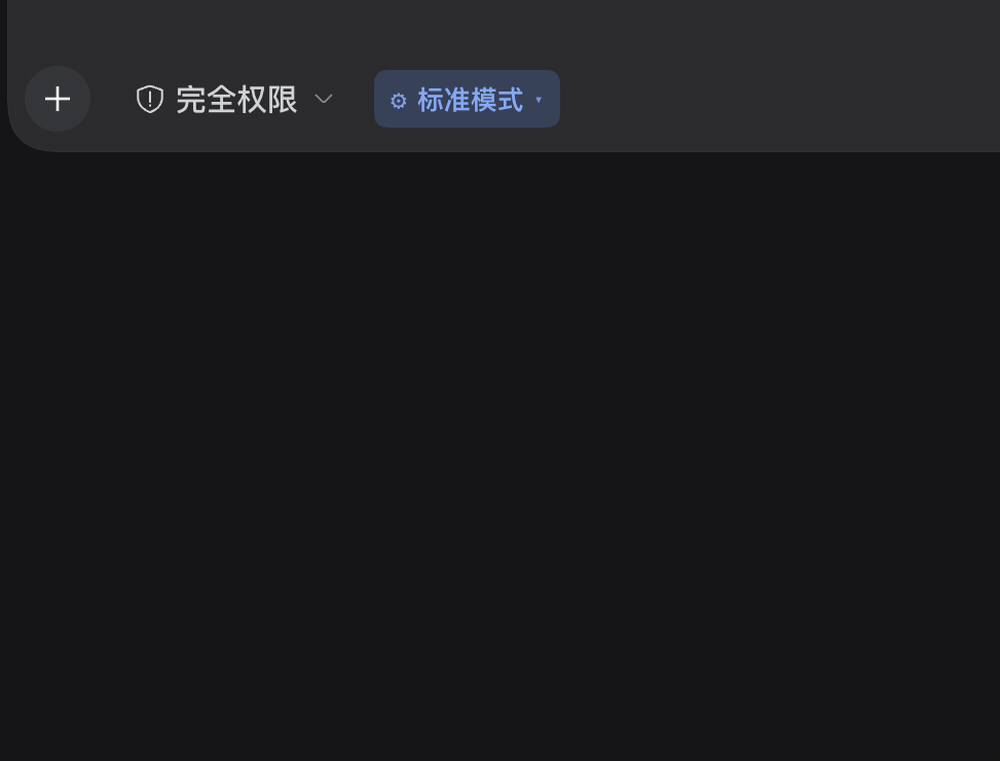
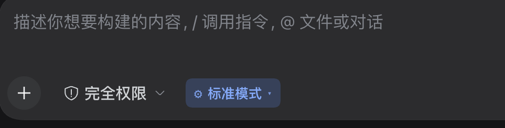
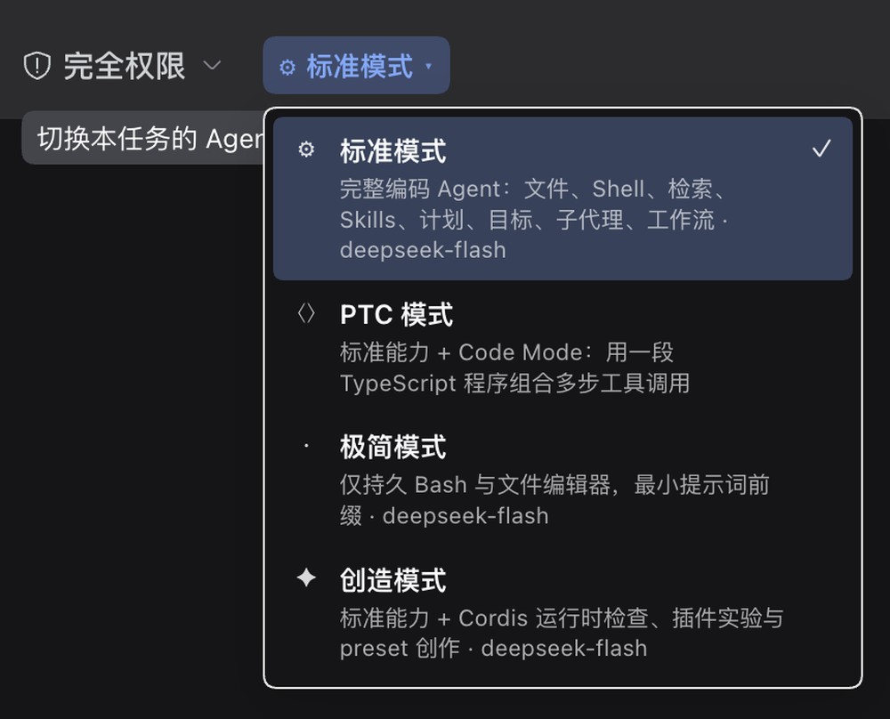
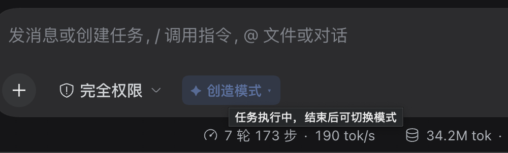

<div align='center'>
  
  <h1>dsh-four-modes</h1>
  <p><b>Switch DeepSeek Harness agent modes mid-conversation</b></p>
  <p>Standard · PTC · Minimal · Creator — one toolbar chip, one <code>/mode</code> command</p>
  <p>
    
    
    
    
  </p>
  <p><a href='./README.md'>简体中文</a> | English</p>
</div>

<p align='center'>
  
</p>

DSH removes the official preset picker as soon as a conversation produces content. **dsh-four-modes** puts a picker back into the composer: a chip that shows the current mode, and a menu that switches it. The switch reuses the DSH `recompose()` path, so the next request rebuilds tool declarations — no new session, no lost context.

---

## 🚀 Quick start

> Requirements: DSH `>= 0.1.1-rc.2`, Node `>= 20`, and pnpm on `PATH` (`dsh plugin` uses it to manage profiles).

```bash
# 1. Install into your profile (replace desktop with your profile name)
dsh plugin --profile desktop add github:chentao326/dsh-four-modes
```

```text
# 2. Reload
#    The host half reloads with the profile; the client bundle needs one page refresh
#    (Cmd/Ctrl+R). If the chip still does not appear, restart DSH once.
```

```text
# 3. Verify
/mode list
# Current mode: standard. Switchable: standard, code, minimal, cordis. Usage: /mode <id>, or /mode next to cycle.
```

> [!TIP]
> Cloned the repository already? Pass the checkout path instead of the GitHub spec: the plugin installs as a `link:` and picks up edits immediately, which is what you want while developing.

## 🤔 Why

DSH ships four built-in agent presets, but the official picker only exists on a **new session** (`conversation.hero.agentPreset`). Once the conversation produces content the preset is frozen; changing it means starting over and losing context.

Earlier community switchers hard-code preset ids (for example `ptc` for PTC mode), while DSH 0.1.1-rc.2 registers that preset as `code` (display name stays `PTC`). Switching PTC then fails with an unknown-mode error.

| | New-session picker | Hard-coded switcher | **dsh-four-modes** |
|---|---|---|---|
| Existing conversation | ❌ | ✅ | ✅ |
| Preset id drift | — | ❌ pinned to one id | ✅ resolved from the live roster, `ptc` and `code` both work |
| Switching while a turn runs | — | possible | ✅ refused between turns only |
| Concurrency | — | not handled | ✅ per-session serial chain |
| Failure recovery | — | none | ✅ repairs the log when bind landed but threw |
| Custom presets | — | unsupported | ✅ listed after the four built-ins |

## 🧩 The four modes

| Mode | Preset id | Tool surface | Best for |
|---|---|---|---|
| **Standard** | `standard` | Files, shell, search, skills, plan, goals, subagents, workflows | Everyday coding |
| **PTC** | `code` (alias `ptc`) | Standard abilities plus Code Mode SDK: compose many tool calls in one TypeScript program | Batch work, complex orchestration |
| **Minimal** | `minimal` | Persistent bash and the file editor only, smallest prompt prefix | Light tasks, token saving |
| **Creator** | `cordis` | Standard abilities plus Cordis inspection, plugin experiments and preset authoring | Writing plugins and presets |

## 🎛️ Usage

### The composer chip

<p align='center'>
  
</p>

Clicking the chip opens the menu. The current mode is checked, every row carries a one-line description, and a row that remembers a model appends that model name.

<p align='center'>
  
</p>

- **Viewport aware**: the composer sits at the bottom, so a menu that would overflow flips upward instead of being clipped.
- **Keyboard friendly**: `Escape` or a click outside closes the menu.
- **Disabled while running**: during a turn the chip is disabled and explains why on hover.
- **Optimistic update**: the chip updates immediately on success; on failure the menu stays open with the reason.

<p align='center'>
  
</p>

### The `/mode` command

| Command | Effect |
|---|---|
| `/mode` or `/mode list` | Show the current mode and the switchable list |
| `/mode standard` | Switch to Standard |
| `/mode ptc` / `/mode code` | Switch to PTC (both ids accepted) |
| `/mode minimal` | Switch to Minimal |
| `/mode cordis` | Switch to Creator |
| `/mode next` | Cycle Standard → PTC → Minimal → Creator → Standard |

Display names (`Standard`, `PTC`, `Minimal`, `Creator`) and case-insensitive id prefixes work too. Custom presets are listed after the four built-ins and can be selected by id or display name.

> [!NOTE]
> While a turn is running, both the chip and the command refuse to switch. The tool surface must not change under the model mid-turn.

## 🧠 Per-mode model memory

Each mode remembers the model you picked for it (reasoning strength included) and reapplies it on switch:

- **Learn**: change the model with the native picker to the right of the composer; the change is recorded for the **current mode** (`localStorage['dsh-four-modes.models.v1']`, kept across sessions and restarts).
- **Apply**: after a successful switch the plugin calls `session.selectModel` with that model; a failure does not roll back the mode switch and is reported in the menu.
- **Show**: the remembered model is appended to the row description, for example `Standard · deepseek-v4-pro`.
- **Clear**: run `localStorage.removeItem('dsh-four-modes.models.v1')` in the browser console.

> [!WARNING]
> In deployments with settings, `session.selectModel` persists the choice as the **deployment default**. Per-mode switching therefore also changes the default model for new sessions. That is DSH behavior, not something this plugin adds. Do not use the feature if you want the change limited to the current session.

## ⚙️ How it works

<details>
<summary>Expand: what happens inside DSH during one switch</summary>

```text
Host half (index.js)
  /mode
    ├─ readRoster()        agentPresets.remoteExportList()     read the preset roster
    ├─ resolveMode()       exact id → alias → display name → prefix
    ├─ turnIsOpen()        agent.status + turnBoundary projection
    ├─ recompose()         agentPresets.recompose(agent.ctx, id)
    ├─ append()            session.append('agent-preset/selected', …)
    └─ agent/pre-step      startsRequestSeries → rebuild tool declarations next request

Client half (client.js)
  conversation.input.left
    ├─ current mode        agentPreset projection, with optimistic update
    ├─ roster              remote.agentPresets.list(), falls back to the four built-ins
    └─ switch              remote.commands.execute(sessionId, '/mode <id>')
```

1. **Official mechanism**: the plugin walks the same `recompose()` + `agent-preset/selected` + `startsRequestSeries` path as the new-session picker. No private state is touched.
2. **Roster adaptive**: every switch re-reads the roster and resolves by exact id, known alias (`ptc` ↔ `code`), display name (Chinese or English), then id prefix. DSH id changes and user-authored presets need no plugin update.
3. **Guards**: switching is refused while a turn is open; a per-session serial chain keeps two switches from interleaving binds; a `recompose` that throws is checked against the actual composition (binding landed means the event is logged and success is reported, no binding means the mark is rolled back); a failed `append` is remembered and repaired by the next request for the same mode.

</details>

## ⚠️ Boundaries and rollback

| Situation | Behavior | Recommendation |
|---|---|---|
| A turn is running | Chip disabled, command returns an error | Switch after the turn ends |
| Switching to a smaller tool surface | Earlier tool calls stay in the log and are not replayed; the next request declares the new tools | Use normally; the model adapts |
| Minimal mode | Only persistent bash and the editor (no `exit_plan_mode` and friends) | Expected; switch back to Standard |
| Uninstalling | Sessions keep their current composition; nothing rolls back | Run `/mode standard` first |
| Restarting DSH | Mode is restored from the `agent-preset/selected` log | If it disagrees, re-run `/mode <id>` to repair |

> [!CAUTION]
> Avoid switching to Minimal in the middle of a long task: with a smaller tool surface the remaining planned steps may no longer be executable. Switch after the task wraps up.

Known limitation: immediately after chained switches, `standard` may briefly lack `subagent` and PTC may briefly lack `workflow`; the next request restores them (115/115 observed). This is DSH preset mounting order, not a plugin issue, and normal tasks are unaffected.

## ❓ FAQ

<details>
<summary>The chip does not appear, or the switch has no effect</summary>

1. Check the profile name: `dsh plugin --profile <name> ls | grep four-modes`.
2. The client bundle is served at page load: **refresh the page** (Cmd/Ctrl+R); restart DSH if the chip is still missing.
3. Edits to `index.js` (the host half) require a DSH restart; it does not hot reload.

</details>

<details>
<summary>The menu is clipped by the composer</summary>

Fixed: the menu is rendered into `document.body` with `createPortal` (so composer ancestors cannot create a containing block), flips upward when space below is short, and is capped with `max-height` plus scrolling.

</details>

<details>
<summary>Can I change the default mode for new sessions</summary>

No. That is a DSH setting (`agent-presets` namespace, `default` field) and is orthogonal to this plugin, which switches the **current** conversation only.

</details>

<details>
<summary>Does switching also change the model</summary>

Only when that mode remembers a model; see [per-mode model memory](#-per-mode-model-memory). Otherwise the model is untouched.

</details>

<details>
<summary>Can I switch to a custom preset</summary>

Yes. Presets you create under `~/.dsh/.agent-presets/` are listed after the four built-ins and are reachable by id or display name.

</details>

## 🧪 Tests

```bash
npm test               # host 26 + roster 32 + client 7
npm run test:browser   # real-Chrome DOM integration, 22 cases
npm run test:all       # all 87
```

Zero dependencies: only Node built-ins and a local Chrome. The browser suite drives headless Chrome over CDP with real mouse and keyboard events through the full load path (`__ModuleLoader__.load → factory → apply`).

<details>
<summary>Expand: the test matrix (as of 2026-11-23)</summary>

| Suite | Covers | Cases |
|---|---|---|
| `test/host.test.mjs` | Command registration, switching and event logging, turn guards, serialization, multi-session isolation, log repair, disposal | 26 |
| `test/host.roster.test.mjs` | Roster read failures, alias/case/whitespace/prefix resolution, broken row filtering, custom preset ordering | 32 |
| `test/client.test.mjs` | Factory registration, `inject`/`apply`, slot registration, current-mode rendering, disabled while running, model memory | 7 |
| `test/client.browser.mjs` | Real Chrome: menu open/close, portal, flip positioning, failure paths, optimistic updates, cross-session isolation | 22 |

</details>

## 📦 Compatibility

- DSH `>= 0.1.1-rc.2` (`engines.dsh`), Node `>= 20`.
- Web client only (`dsh.client.platform: web`); the host half is plain Node with no platform dependency.
- Orthogonal to the DSH `agent-presets` default setting. Do not install it alongside another plugin that registers `/mode`.
- Copy follows the DSH UI language: `locale/zh.json` and `locale/en.json`.

## 🛠️ Development

```text
dsh-four-modes/
├── index.js            host half: /mode, roster resolution, switching and serialization
├── client.js           client half: composer chip, menu, model memory
├── cordis.patch.yml    profile bundle patch layer
├── locale/             zh and en copy
├── icon.svg
├── test/               four zero-dependency suites
├── docs/images/        README assets
└── .github/workflows/  CI (Node 22/24 unit suites + real-Chrome suite)
```

```bash
# Install as a link so edits apply immediately
dsh plugin --profile desktop add /absolute/path/to/dsh-four-modes

npm test             # unit suites
npm run test:browser # browser integration
```

- `client.js` changes hot reload through `dsh-client-hmr`; `index.js` changes require a DSH restart.
- Release: bump `version` in `package.json`, then `git tag vX.Y.Z && git push --tags`.

## 📄 License

MIT © 2026 [chentao326](https://github.com/chentao326). Questions and issues: [open an issue](https://github.com/chentao326/dsh-four-modes/issues).

> Reference implementation: the shipped DSH preset picker (`agentPresets.recompose` + `agent-preset/selected` + `startsRequestSeries`).
