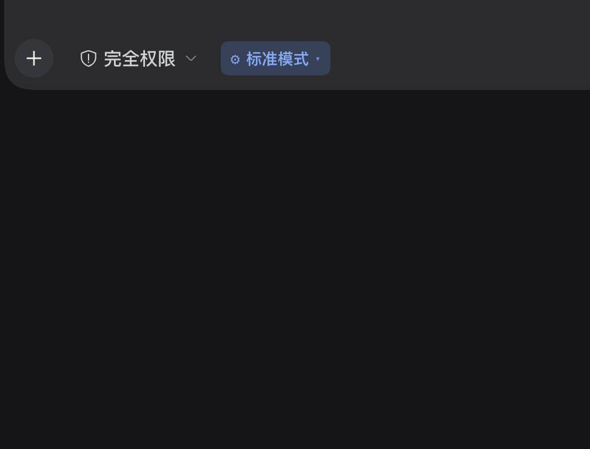
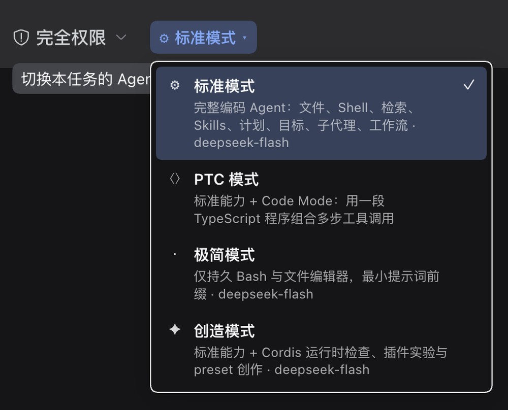
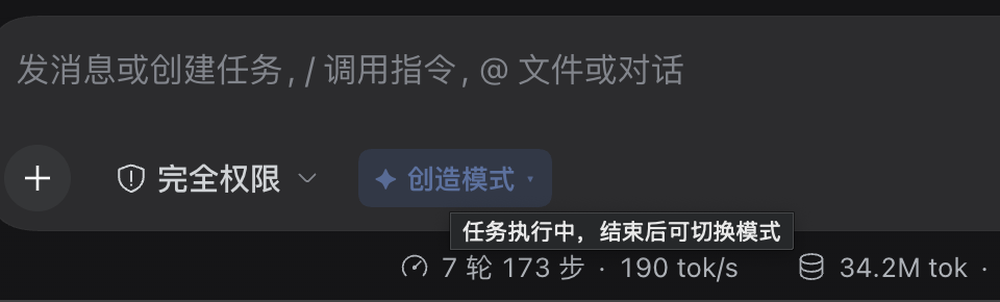

<div align='center'>
  
  <h1>dsh-four-modes</h1>
  <p><b>在已经开始的会话里，随时切换 DeepSeek Harness 的四种 Agent 模式</b></p>
  <p>标准 · PTC · 极简 · 创造 —— 一个工具栏 chip，一条 <code>/mode</code> 命令</p>
  <p>
    
    
    
    
  </p>
  <p>简体中文 | <a href='./README.en.md'>English</a></p>
</div>

<p align='center'>
  
</p>

项目一旦产出内容，DSH 官方的 preset 选择器就消失了。**dsh-four-modes** 把选择器装回输入框：一个显示当前模式的 chip，点开即切；也可以直接输入 `/mode next`。切换复用 DSH 自己的 `recompose()` 机制，下一轮请求按新模式重建工具声明 —— 不重开会话，不丢上下文。

---

## 🚀 30 秒上手

> 前提：DSH `>= 0.1.1-rc.2`、Node `>= 20`、pnpm 在 `PATH` 上（`dsh plugin` 用它管理 profile）。

```bash
# 1. 装进你的 profile（把 desktop 换成你的 profile 名）
dsh plugin --profile desktop add github:chentao326/dsh-four-modes
```

```text
# 2. 重新加载
#    Host 半侧随 profile 热重载生效；客户端 bundle 需要刷新一次页面
#    （Cmd/Ctrl+R；若 chip 仍未出现，重启一次 DSH）
```

```text
# 3. 验证
/mode list
# 当前模式：standard。可切换：standard, code, minimal, cordis。用法：/mode <id>，或 /mode next 轮换。
```

> [!TIP]
> 已经克隆了仓库？把 `github:chentao326/dsh-four-modes` 换成仓库的绝对路径：插件会以 `link:` 方式接入，改完即时生效，适合开发。

装好后输入框工具栏会多出一个模式 chip。点它选一个模式，下一轮对话就使用该模式的工具集与提示词。

## 🤔 为什么需要它

DSH 自带四种内置 Agent 模式（preset），但官方只在**新建会话**时提供选择器（`conversation.hero.agentPreset`）。会话一旦产出内容便无法更换 preset —— 想换只能重开会话，上下文全部丢掉。

早期社区方案把 PTC 的 preset id 硬编码成 `ptc`，而 0.1.1-rc.2 实际注册的 id 是 `code`（显示名仍为「PTC 模式」），于是切 PTC 会报「未知模式」。

| | 只能新建会话时切 | 硬编码 id 的切换插件 | **dsh-four-modes** |
|---|---|---|---|
| 已开始的会话 | ❌ | ✅ | ✅ |
| preset id 版本漂移 | — | ❌ 硬编码 `ptc` | ✅ 按名册解析，`ptc` / `code` 都认 |
| 切换时机 | — | 可能在 turn 执行中切换 | ✅ 执行中拒绝，turn 之间才允许 |
| 并发安全 | — | 未处理 | ✅ per-Session 串行链 |
| 失败恢复 | — | 无 | ✅ 按实际组合补记事件 |
| 自定义 preset | — | 不支持 | ✅ 自动列在四个内置模式之后 |

## 🧩 四个模式

| 模式 | preset id | 工具面 | 适合 |
|---|---|---|---|
| **标准模式** | `standard` | 文件、Shell、检索、Skills、计划、目标、子代理、工作流 | 日常编码 |
| **PTC 模式** | `code`（别名 `ptc`） | 标准能力 + Code Mode SDK：把多步工具调用编排进一段 TypeScript 程序 | 批量操作、复杂编排 |
| **极简模式** | `minimal` | 仅持久 Bash + 文件编辑器，最小提示词前缀 | 轻量任务、省 token |
| **创造模式** | `cordis` | 标准能力 + Cordis 运行时检查、插件实验、preset 创作 | 写插件、调 preset |

## 🎛️ 怎么用

### 工具栏 chip

<p align='center'>
  
</p>

点击 chip 展开菜单：当前模式打勾，每项带一句能力说明；用过「模式 + 模型」组合的话，说明后会追加记忆的模型名。

<p align='center'>
  
</p>

- **视口自适应**：输入框贴着窗口底部，下方空间不足时菜单向上展开，永远不会被 composer 裁掉。
- **键盘友好**：`Escape`、点击菜单外任意位置都会关闭。
- **执行中禁用**：turn 进行时 chip 处于禁用态，鼠标悬停显示「任务执行中，结束后可切换模式」。
- **乐观更新**：切换成功后 chip 立即更新，不等 projection 回流；失败时菜单常驻并显示原因。

<p align='center'>
  
</p>

### `/mode` 命令

| 命令 | 作用 |
|---|---|
| `/mode` 或 `/mode list` | 查看当前模式与可切换清单 |
| `/mode standard` | 切到标准模式 |
| `/mode ptc` / `/mode code` | 切到 PTC 模式（两个 id 都接受） |
| `/mode minimal` | 切到极简模式 |
| `/mode cordis` | 切到创造模式 |
| `/mode next` | 按 标准 → PTC → 极简 → 创造 → 标准 轮换 |

除了 preset id，也可以输入显示名（`标准` / `Standard` / `PTC` / `Minimal` / `Creator`）或 id 前缀；自定义 preset 会排在四个内置模式之后，用 `/mode <id>` 或显示名都能切。

> [!NOTE]
> turn 未结束时，chip 与命令都会拒绝切换。工具集不能在模型正在工作时被换掉。

## 🧠 按模式记忆模型

每个模式会记住你为它选的模型（含推理强度），切换时自动应用：

- **学习**：用输入框右侧的原生模型选择器改一次模型，改动记到**当前模式**（`localStorage['dsh-four-modes.models.v1']`，跨会话、跨重启保留）。
- **应用**：切换成功后调用 `session.selectModel` 切到该模式记忆的模型；失败不影响模式切换，菜单会显示原因。
- **显示**：菜单项说明后追加已记忆的模型名，例如 `标准模式 · deepseek-v4-pro`。
- **清除**：浏览器控制台执行 `localStorage.removeItem('dsh-four-modes.models.v1')`。

> [!WARNING]
> DSH 的 `session.selectModel` 在带 settings 的部署里会把选择保存为**部署默认值**。因此按模式切模型会同时改变「新会话的默认模型」——这是 DSH 自身语义，不是插件额外做的。只想让当前会话变、不影响新会话时，请不要使用这个功能。

## ⚙️ 工作原理

<details>
<summary>展开：切换一次模式，DSH 内部发生了什么</summary>

```text
Host 半侧 (index.js)
  /mode
    ├─ readRoster()        agentPresets.remoteExportList()     读 preset 名册
    ├─ resolveMode()       精确 id → 别名 → 显示名 → 前缀     跨版本解析
    ├─ turnIsOpen()        agent.status + turnBoundary projection
    ├─ recompose()         agentPresets.recompose(agent.ctx, id)
    ├─ append()            session.append('agent-preset/selected', …)
    └─ agent/pre-step      startsRequestSeries → 下一轮重建工具声明

Client 半侧 (client.js)
  conversation.input.left
    ├─ 当前模式            会话 projection 的 agentPreset（含乐观更新）
    ├─ 名册                remote.agentPresets.list()（失败回退四个内置）
    └─ 切换                remote.commands.execute(sessionId, '/mode <id>')
```

1. **复用官方机制**：与「新建会话时选 preset」走同一条 `recompose()` + `agent-preset/selected` + `startsRequestSeries` 路径，不碰私有状态。
2. **名册自适应**：每次切换前重新读名册，按「精确 id → 已知别名（`ptc` ↔ `code`）→ 显示名（中/英）→ id 前缀」解析。DSH 换 id、用户自定义 preset，都不用改插件。
3. **安全护栏**：turn 执行中拒绝；per-Session 串行链保证两次切换不会交错绑定；`recompose` 抛错后先查实际组合 —— 已 bind 则补记事件并返回成功，未 bind 则回滚标记；`append` 失败会标记待补，下次同模式请求自动补记。

</details>

## ⚠️ 边界与回滚

| 场景 | 行为 | 建议 |
|---|---|---|
| 任务执行中 | chip 禁用，命令返回错误 | 等这一轮结束再切 |
| 切到工具更少的模式 | 历史工具调用留在日志中、不会重放；下一轮按新工具集声明 | 正常使用，模型会改用新工具 |
| 极简模式 | 只有持久 Bash + 文件编辑器（没有 `exit_plan_mode` 等工具） | 预期行为，切回标准模式即可 |
| 卸载插件 | 已切换的会话保留当前组合，不自动回滚 | 卸载前先 `/mode standard` |
| 重启 DSH | 按日志里的 `agent-preset/selected` 恢复 | 如不一致，重跑 `/mode <id>` 补记 |

> [!CAUTION]
> 不要在长任务中途切到极简模式：工具集变小后，原计划里的步骤可能无法继续执行。等任务收尾再切。

已知限制：链式切换后立即采样，`standard` 偶见缺 `subagent`、PTC 偶见缺 `workflow`；下一次请求即恢复（实测 115/115）。这是 DSH preset 挂载内部的工具注册时序，不影响普通任务。

## ❓ 常见问题

<details>
<summary>装完 chip 没出现 / 切了没生效？</summary>

1. 确认 profile 名对得上：`dsh plugin --profile <name> ls | grep four-modes`。
2. 客户端 bundle 只在页面加载时下发，**刷新页面**（Cmd/Ctrl+R）；仍不出现就重启 DSH。
3. 改了 `index.js`（Host 半侧）必须重启 DSH，它不会热更新。

</details>

<details>
<summary>菜单被输入框裁掉了？</summary>

已修复：菜单通过 `createPortal` 渲染到 `document.body`（避免 composer 祖先的 transform/overflow 形成新的 containing block），下方空间不足时反向向上展开，并限制 `max-height` + 滚动。

</details>

<details>
<summary>能设置「新会话默认模式」吗？</summary>

不能。那是 DSH 自带设置（`agent-presets` 命名空间的 `default` 字段），与本插件正交。本插件只负责切换**当前会话**的模式。

</details>

<details>
<summary>切换模式会顺手换掉模型吗？</summary>

只有该模式记忆过模型时才会换，见[按模式记忆模型](#-按模式记忆模型)。没有记忆时模型保持不变。

</details>

<details>
<summary>可以切自定义 preset 吗？</summary>

可以。你自己在 `~/.dsh/.agent-presets/` 下建的 preset 会列在菜单里四个内置模式之后，`/mode <id>` 或显示名都能切换。

</details>

## 🧪 测试与验证

```bash
npm test               # Host 26 + 名册 32 + Client 7
npm run test:browser   # 真实 Chrome DOM 集成 22（需本机或 CI 中的 Chrome）
npm run test:all       # 全部 87 项
```

默认零依赖：只用 Node 内置模块与本机 Chrome。浏览器套件通过 CDP 驱动 headless Chrome，用真实鼠标/键盘事件走完整加载链路（`__ModuleLoader__.load → factory → apply`）。

<details>
<summary>展开：测试矩阵与覆盖范围（截至 2026-11-23）</summary>

| 套件 | 覆盖 | 用例 |
|---|---|---|
| `test/host.test.mjs` | 命令注册、切换与事件落盘、turn 守卫、串行化、多会话隔离、log 补记、disposed 清理 | 26 |
| `test/host.roster.test.mjs` | 名册读取失败、别名/大小写/空格/前缀解析、坏行过滤、自定义 preset 排序 | 32 |
| `test/client.test.mjs` | 工厂注册、`inject`/`apply`、slot 注册、当前模式渲染、执行中禁用、模型记忆 | 7 |
| `test/client.browser.mjs` | 真实 Chrome：菜单开合、portal、定位翻转、失败路径、乐观更新、跨会话隔离 | 22 |

</details>

## 📦 兼容性

- DSH `>= 0.1.1-rc.2`（`engines.dsh`），Node `>= 20`。
- 仅 Web 客户端（`dsh.client.platform: web`）；Host 半侧是纯 Node，无平台依赖。
- 与 DSH 的 `agent-presets` 默认值设置正交；不要和其它注册 `/mode` 的 preset 切换插件同时安装。
- 文案跟随 DSH 界面语言：`locale/zh.json` 与 `locale/en.json`。

## 🛠️ 开发

```text
dsh-four-modes/
├── index.js            Host 半侧：/mode 命令、名册解析、切换与串行化
├── client.js           客户端半侧：输入框 chip、菜单、模型记忆
├── cordis.patch.yml    profile bundle 补丁层
├── locale/             zh / en 文案
├── icon.svg
├── test/               4 个套件，零依赖
├── docs/images/        README 素材
└── .github/workflows/  CI（Node 22/24 单测 + 真实 Chrome 套件）
```

```bash
# 以 link 方式装进 profile，改完即可观察
dsh plugin --profile desktop add /absolute/path/to/dsh-four-modes

npm test             # 单元测试
npm run test:browser # 浏览器集成
```

- 改 `client.js`：`dsh-client-hmr` 自动重载；改 `index.js`：必须重启 DSH。
- 发布新版本：更新 `package.json` 的 `version` → `git tag vX.Y.Z && git push --tags`。

## 📄 License

MIT © 2026 [chentao326](https://github.com/chentao326)。问题与建议请开 [Issue](https://github.com/chentao326/dsh-four-modes/issues)。

> 参考实现：DSH 自带的 preset picker（`agentPresets.recompose` + `agent-preset/selected` + `startsRequestSeries`）。
